# Concept Map Penelitian Disertasi

**Judul:** Pengendalian Gas dan Debu Tambang Batubara Bawah Tanah pada Area Penambangan Aktif dan Goaf di Indonesia

Diagram ini menggunakan sintaks [Mermaid](https://mermaid.js.org/), yang dapat dirender langsung di GitHub README atau berkas Markdown.

```mermaid
flowchart TB
    START([MULAI]) --> I

    subgraph PREP["Tahap I - Persiapan dan Studi Literatur"]
        direction TB
        I["Rumusan masalah dan tujuan penelitian"] --> H["Hipotesis dan variabel penelitian"]
        H --> L["Studi literatur: gas, debu, ventilasi, dan goaf"]
    end

    L --> FIELD
    L --> LAB

    subgraph DATA["Tahap II - Pengumpulan dan Karakterisasi Data"]
        direction LR
        subgraph LAP["Data Lapangan"]
            direction TB
            FIELD["Kondisi aktivitas penambangan dan goaf"] --> FG["Pengukuran CH4, CO, CO2, dan debu respirabel"]
            FG --> FV["Pengukuran debit, kecepatan, dan tekanan ventilasi"]
        end
        subgraph LABOR["Data Laboratorium"]
            direction TB
            LAB["Karakteristik dan rank batubara"] --> LP["Porositas dan sifat fisik-kimia debu"]
            LP --> LG["Desorpsi gas dan potensi swabakar"]
        end
    end

    FV --> ANA
    LG --> ANA

    subgraph MODEL["Tahap III - Analisis dan Pemodelan Numerik"]
        direction TB
        ANA["Analisis statistik dan korelasi parameter"] --> VENT["Pemodelan jaringan ventilasi - VentSim"]
        VENT --> CFD["Simulasi CFD: aliran udara, gas, dan debu"]
        CFD --> MIG["Pola distribusi, migrasi, dan interaksi area aktif-goaf"]
        MIG --> VAL{"Model sesuai data lapangan?"}
    end

    VAL -- "Belum" --> VENT
    VAL -- "Ya" --> EVAL

    subgraph EVALUASI["Tahap IV - Evaluasi Sistem Eksisting"]
        direction TB
        EVAL["Evaluasi efektivitas pengendalian saat ini"] --> BASE["Indikator dasar: konsentrasi, paparan, kebocoran udara, dan risiko"]
    end

    BASE --> OPT

    subgraph STRATEGI["Tahap V - Pengembangan Strategi Terintegrasi"]
        direction TB
        OPT["Optimasi ventilasi"] --> GOAF["Pengendalian atmosfer goaf: sealing dan inertisasi sesuai kondisi"]
        GOAF --> DUST["Pengendalian debu: water spray dan penangkapan debu"]
        DUST --> SIM["Simulasi skenario gabungan dan evaluasi risiko"]
    end

    SIM --> ENDSTAGE

    subgraph HASIL["Tahap VI - Kesimpulan dan Rekomendasi"]
        direction TB
        ENDSTAGE["Pengujian hipotesis dan sintesis hasil"] --> REC["Rekomendasi pengendalian gas-debu yang terintegrasi"]
        REC --> NOV["Kontribusi ilmiah dan batasan penelitian"]
    end

    NOV --> FIN([SELESAI])

    classDef startEnd fill:#173b69,color:#ffffff,stroke:#12304f,stroke-width:2px;
    classDef prep fill:#e9f7e9,color:#133c20,stroke:#2b9952;
    classDef data fill:#e4f3ff,color:#103e62,stroke:#3294cf;
    classDef model fill:#fff0dc,color:#684011,stroke:#e88825;
    classDef eval fill:#fff7d4,color:#594700,stroke:#d6b51b;
    classDef strategy fill:#f1e6fa,color:#50256b,stroke:#9857bc;
    classDef result fill:#fbe4f0,color:#6b214c,stroke:#c04d91;
    classDef check fill:#ffffff,color:#8b2519,stroke:#c24f37,stroke-width:2px;

    class START,FIN startEnd;
    class I,H,L prep;
    class FIELD,FG,FV,LAB,LP,LG data;
    class ANA,VENT,CFD,MIG model;
    class EVAL,BASE eval;
    class OPT,GOAF,DUST,SIM strategy;
    class ENDSTAGE,REC,NOV result;
    class VAL check;
```



## Cara menampilkan di GitHub

1. Buat atau buka `README.md` pada repositori.
2. Salin blok kode mulai dari `` ```mermaid `` sampai penutup `` ``` `` ke README.
3. Commit perubahan; GitHub akan menampilkan diagram otomatis.

**Catatan metodologis:** Tahap II terdiri atas dua sumber data yang saling melengkapi. Validasi model dilakukan sebelum pemodelan digunakan untuk mengevaluasi dan mengoptimasi strategi pengendalian. Seluruh rancangan pengujian dan perubahan ventilasi pada tambang aktif harus memenuhi prosedur keselamatan serta izin teknis yang berlaku.
